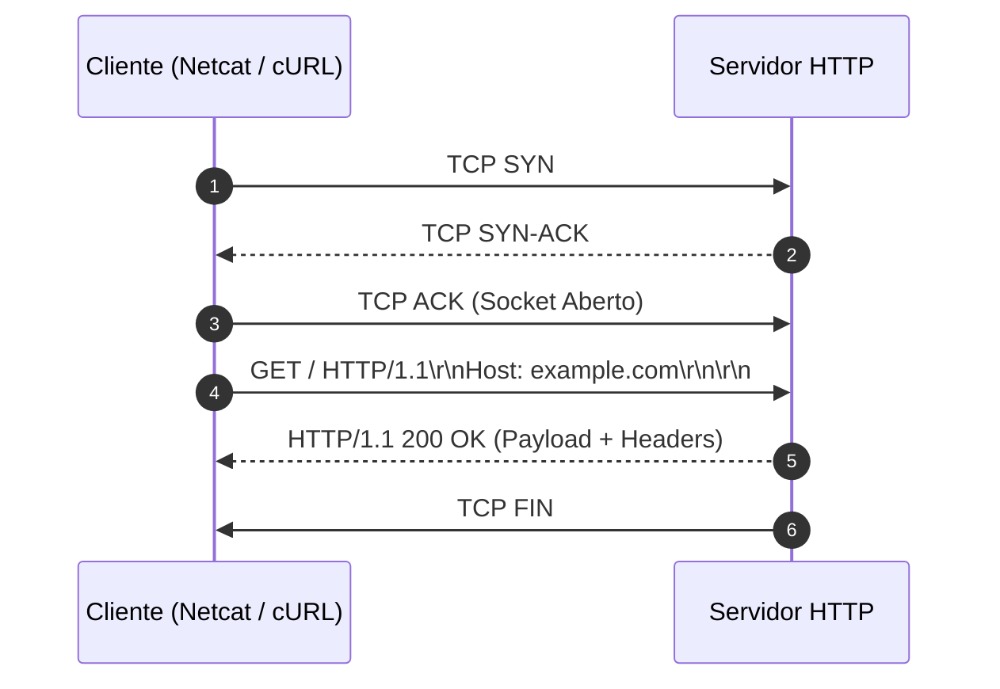

# Memória de Desenvolvimento — Semana 01: Protocolo HTTP & Sockets Bare-Metal
**Aluno:** [Gabriel Balduino]  
**Matrícula:** [202011200277]  
**Curso:** Ciência / Engenharia da Computação  

---

## 1. Mapeamento da Camada de Transporte
Diagrama Mermaid demonstrando o ciclo de vida da requisição executada no laboratório:

---

## 2. Registro dos Experimentos de Laboratório

### Experimento 1: Netcat Nu & Falha 400 Bad Request
* **Comando Testado:** `nc -C example.com 80` sem o header `Host:`
* **Resultado:** 400 Bad Request. O campo Host no HTTP/1.1 permite que um único servidor físico com um único endereço IP hospede múltiplos sites diferentes e sem esse cabeçalho, o servidor não tem como saber a qual domínio a requisição se destina e não consegue direcioná-la para os arquivos e configurações certos.

### Experimento 2: Semântica dos Métodos HTTP
* **Análise dos Verbos:** GET: Leitura ou recuperação de recursos. Como não deve alterar o estado do servidor, pode ser repetido várias vezes sem efeitos colaterais indesejados. 

POST: É utilizado para criar novos recursos ou processar dados. Ele altera o estado do servidor, e requisições repetidas podem criar múltiplos registros idênticos. 

OPTIONS: Serve para consultar quais métodos HTTP, cabeçalhos ou políticas de segurança (como o CORS) o servidor ou um recurso específico suporta. É muito utilizado por navegadores modernos em requisições de pré-voo (preflight requests) antes de enviar um POST ou PUT complexo originado de outro domínio.

* **Header Content-Length:** Como o TCP entrega um fluxo contínuo de bytes sem divisão nativa de mensagens, o tamanho do payload determina quantas leituras sucessivas (reads) a aplicação precisa fazer no buffer do socket e indica o ponto exato onde a mensagem termina; isso evita que o servidor trave esperando por dados inexistentes, impede o vazamento de bytes para a requisição seguinte em conexões reutilizadas (Keep-Alive) e permite ao sistema operacional controlar a velocidade de envio para não estourar a memória.

### Experimento 3: URL, Query Strings & Percent-Encoding
* **URL Testada: (Passo 1)** curl -v http://httpbin.org/get?curso=Engenharia da Computacao
* **URL Testada: (Passo 2)** curl -v https://httpbin.org/get?curso=Engenharia%20da%20Computa%C3%A7%C3%A3o
* **O erro no Passo 1:** O que o terminal retornou ao tentar rodar a URL com espaços reais?
---
* Connection #0 to host httpbin.org left intact
* Could not resolve host: da
* shutting down connection #1
curl: (6) Could not resolve host: da
* Could not resolve host: Computacao
* shutting down connection #2
curl: (6) Could not resolve host: Computacao
---
* **A função do `%20`:** Padrão ASCII. Evita que espaços quebrem a interpretação do link e garante que computadores do mundo todo leiam acentos e símbolos de forma idêntica e sem erros.

### Experimento 4: Negociação de Conteúdo & User-Agent
* **Análise:** Como o servidor reage ao receber diferentes cabeçalhos `Accept` e `User-Agent`?
* O Accept informa ao servidor os formatos de dados que o cliente aceita receber
* O User-Agent envia uma string detalhando o software, sistema operacional e dispositivo do cliente

### Experimento 5: Redirecionamentos & Cache Condicional
* **Redirecionamento (301):** Qual a diferença ao executar `curl -I` com e sem a flag `-L`?
* **Validação de Cache (304):** Explique como o header `If-None-Match` e a `ETag` evitam retransmissão de dados na rede.

---

## 3. Conclusão Técnica

Compreender a transmissão de bytes ASCII e a sintaxe de quebra de linha CRLF (\r\n) na camada de aplicação é fundamental porque a maioria dos protocolos estruturados da internet (como HTTP, SMTP e Redis) opera nativamente como fluxos de texto baseados em regras rígidas sobre o TCP. Dominar essa base permite inspecionar o tráfego bruto com precisão milimétrica, depurar anomalias de rede rapidamente e construir parsers customizados altamente eficientes, eliminando o overhead de abstrações desnecessárias.

Em sistemas distribuídos e de alta performance, o controle rigoroso sobre como os bytes e delimitadores são lidos do buffer evita falhas críticas de framing — como vulnerabilidades de HTTP Request Smuggling, causadas por ambiguidades na interpretação de cabeçalhos e quebras de linha. Garantir essa precisão assegura a interoperabilidade segura entre diferentes tecnologias, otimiza o uso da memória e resulta em serviços resilientes, previsíveis e capazes de escalar com baixa latência.
